<!-- Generated by likec4 export markdown. Do not edit manually. -->

# Stratum harness

### Full lane

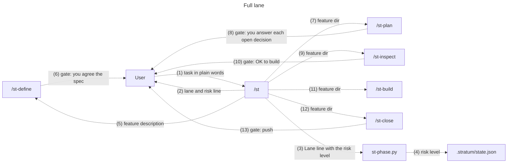

### Full lane: Define

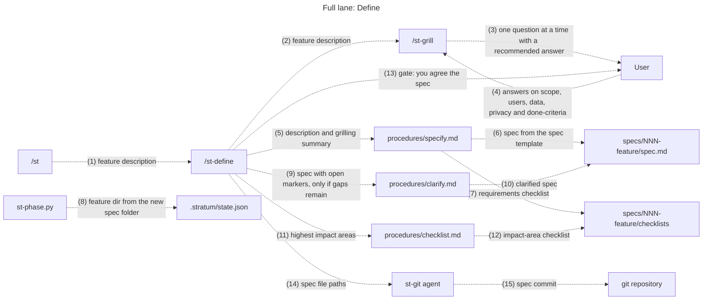

### Full lane: Plan

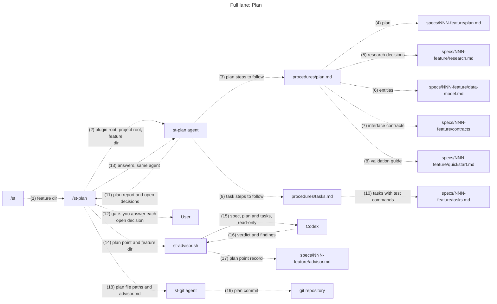

### Full lane: Inspect

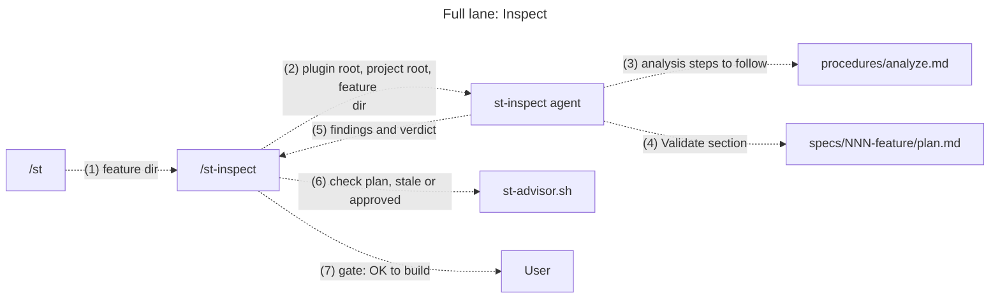

### Full lane: Build

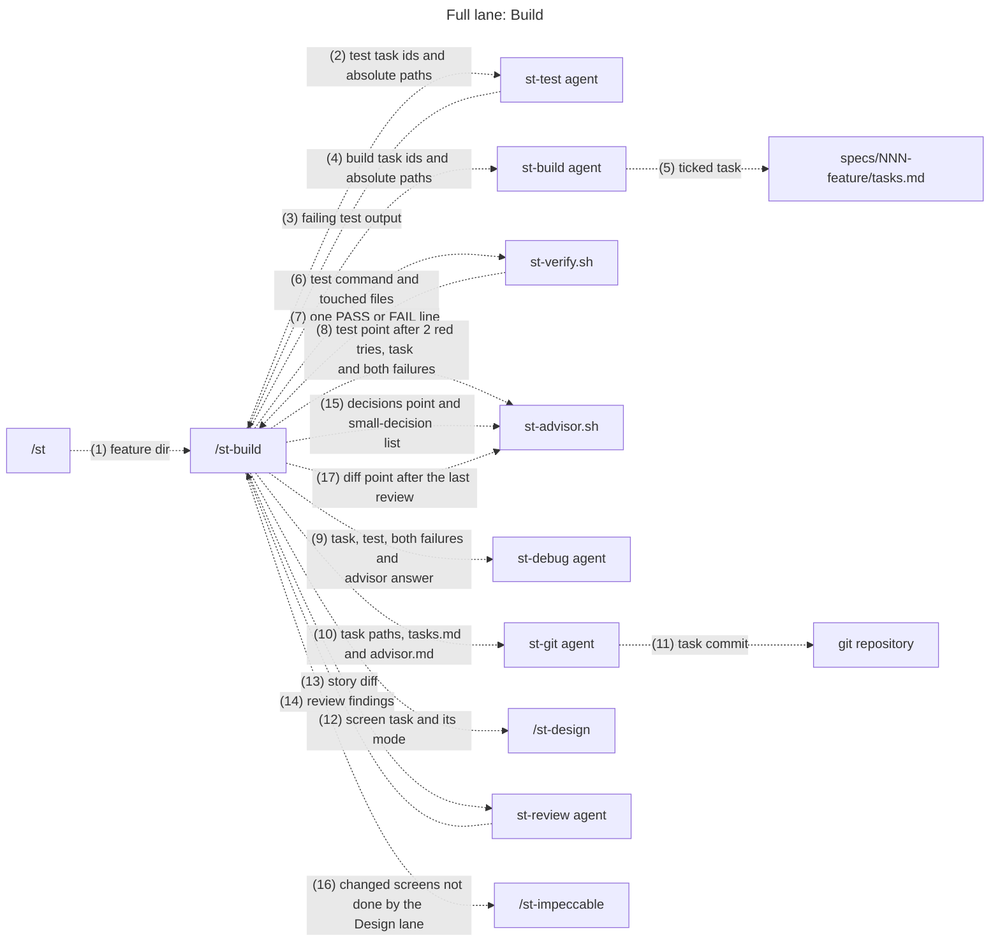

### Full lane: Close

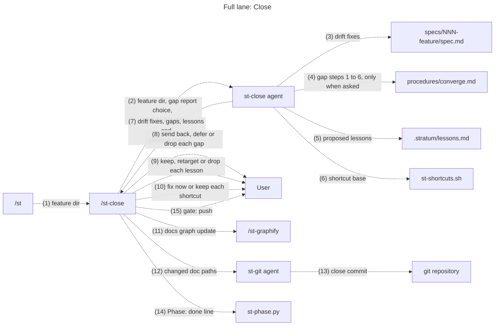

### Fast lane

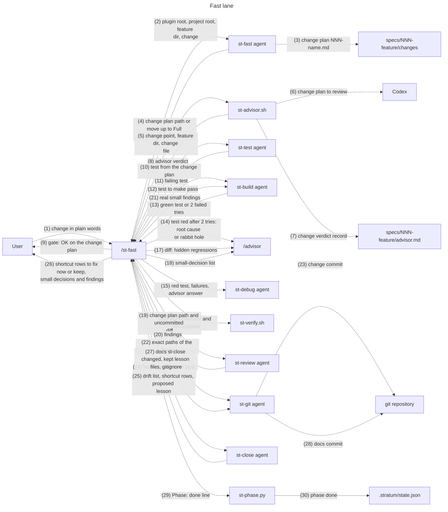

### Quick lane

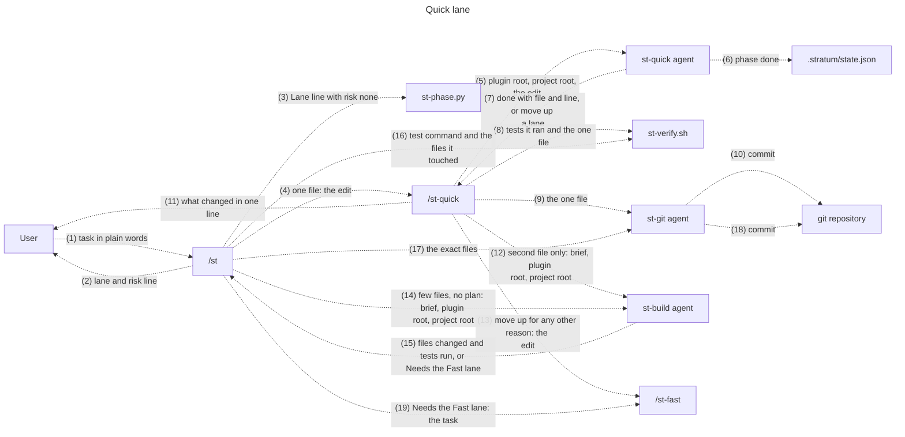

### Design lane

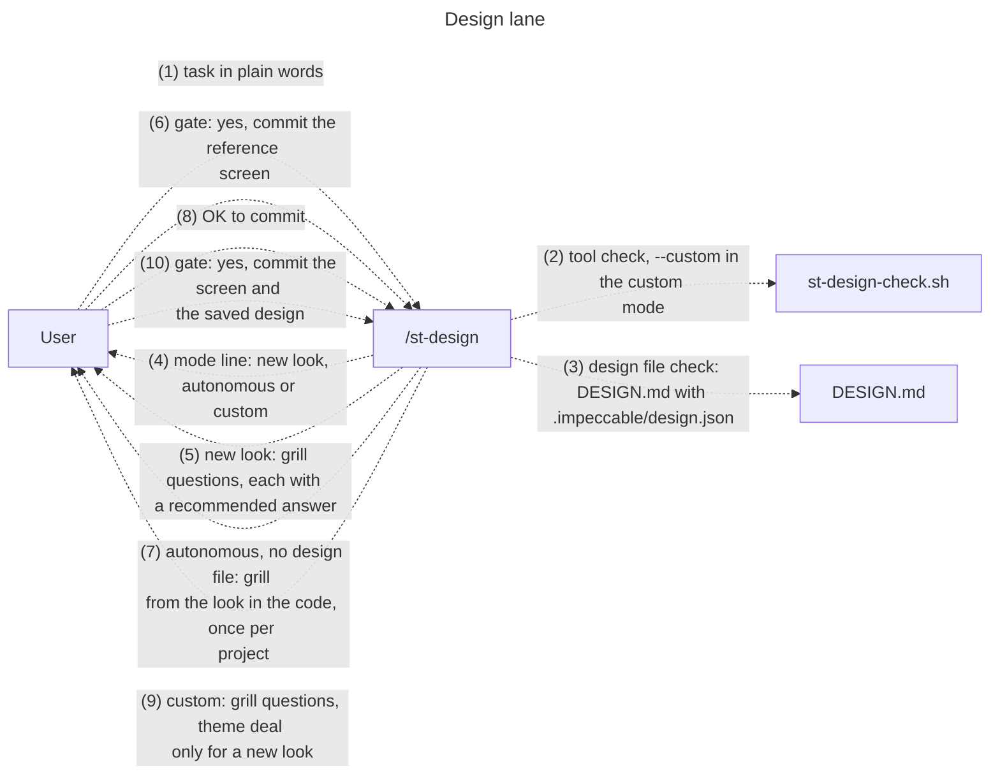

### Design lane: New look

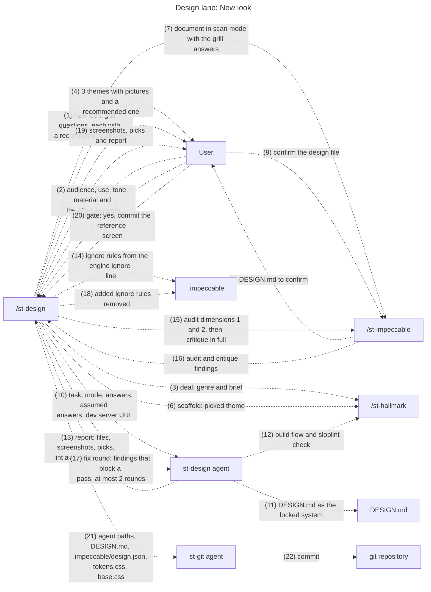

### Design lane: Autonomous

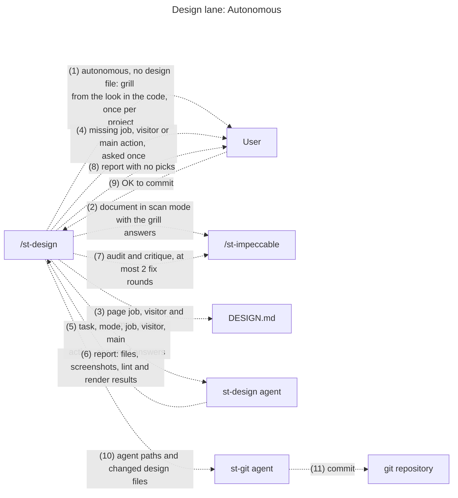

### Design lane: Custom

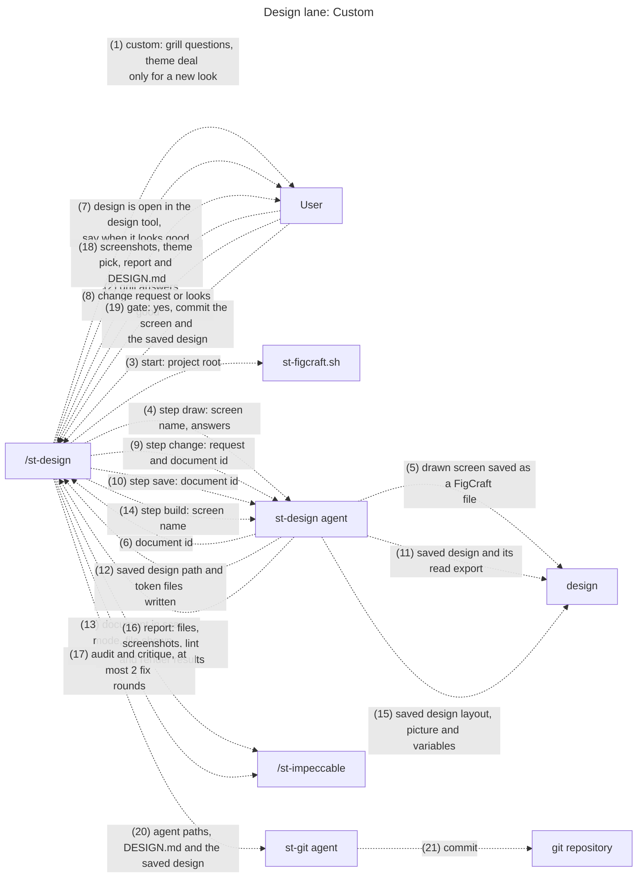

### Agents

```mermaid
---
title: "Agents"
---
graph TB
  SkillsSt@{ shape: rectangle, label: "/st" }
  SkillsSt_fast@{ shape: rectangle, label: "/st-fast" }
  SkillsSt_quick@{ shape: rectangle, label: "/st-quick" }
  SkillsSt_define@{ shape: rectangle, label: "/st-define" }
  SkillsSt_plan@{ shape: rectangle, label: "/st-plan" }
  SkillsSt_inspect@{ shape: rectangle, label: "/st-inspect" }
  SkillsSt_build@{ shape: rectangle, label: "/st-build" }
  SkillsSt_close@{ shape: rectangle, label: "/st-close" }
  SkillsSt_research@{ shape: rectangle, label: "/st-research" }
  SkillsSt_review@{ shape: rectangle, label: "/st-review" }
  SkillsSt_test@{ shape: rectangle, label: "/st-test" }
  SkillsSt_debug@{ shape: rectangle, label: "/st-debug" }
  SkillsSt_git@{ shape: rectangle, label: "/st-git" }
  SkillsSt_triage@{ shape: rectangle, label: "/st-triage" }
  SkillsSt_worker@{ shape: rectangle, label: "/st-worker" }
  SkillsSt_constitution@{ shape: rectangle, label: "/st-constitution" }
  AgentsSt_impeccable@{ shape: rectangle, label: "st-impeccable agent" }
  AgentsSt_ponytail_audit@{ shape: rectangle, label: "st-ponytail-audit agent" }
  AgentsSt_ponytail_debt@{ shape: rectangle, label: "st-ponytail-debt agent" }
  AgentsSt_fast@{ shape: rectangle, label: "st-fast agent" }
  AgentsSt_quick@{ shape: rectangle, label: "st-quick agent" }
  AgentsSt_inspect@{ shape: rectangle, label: "st-inspect agent" }
  AgentsSt_plan@{ shape: rectangle, label: "st-plan agent" }
  AgentsSt_build@{ shape: rectangle, label: "st-build agent" }
  AgentsSt_close@{ shape: rectangle, label: "st-close agent" }
  AgentsSt_research@{ shape: rectangle, label: "st-research agent" }
  AgentsSt_review@{ shape: rectangle, label: "st-review agent" }
  AgentsSt_test@{ shape: rectangle, label: "st-test agent" }
  AgentsSt_debug@{ shape: rectangle, label: "st-debug agent" }
  AgentsSt_triage@{ shape: rectangle, label: "st-triage agent" }
  SkillsSt_impeccable@{ shape: rectangle, label: "/st-impeccable" }
  SkillsSt_ponytail_audit@{ shape: rectangle, label: "/st-ponytail-audit" }
  SkillsSt_ponytail_debt@{ shape: rectangle, label: "/st-ponytail-debt" }
  User@{ shape: rectangle, label: "User" }
  SkillsSt_design@{ shape: rectangle, label: "/st-design" }
  SkillsSt_ui_ux@{ shape: rectangle, label: "/st-ui-ux" }
  SkillsSt_ponytail_review@{ shape: rectangle, label: "/st-ponytail-review" }
  AgentsSt_design@{ shape: rectangle, label: "st-design agent" }
  AgentsSt_git@{ shape: rectangle, label: "st-git agent" }
  SkillsSt -. "`brief, plugin root and project root`" .-> AgentsSt_build
  SkillsSt -. "`exact files to commit`" .-> AgentsSt_git
  SkillsSt_fast -. "`test to make pass and small review fixes`" .-> AgentsSt_build
  SkillsSt_fast -. "`base commit for the drift fix and 
shortcut list`" .-> AgentsSt_close
  SkillsSt_fast -. "`test red after 2 tries and the advisor 
answer`" .-> AgentsSt_debug
  SkillsSt_fast -. "`plugin root, project root, feature dir 
and change`" .-> AgentsSt_fast
  SkillsSt_fast -. "`exact paths and drift docs`" .-> AgentsSt_git
  SkillsSt_fast -. "`change plan path and uncommitted diff`" .-> AgentsSt_review
  SkillsSt_fast -. "`test from the change plan`" .-> AgentsSt_test
  SkillsSt_quick -. "`brief for a fix that needs a second file`" .-> AgentsSt_build
  SkillsSt_quick -. "`the edited files`" .-> AgentsSt_git
  SkillsSt_quick -. "`plugin root, project root and edit`" .-> AgentsSt_quick
  SkillsSt_define -. "`spec files to commit`" .-> AgentsSt_git
  SkillsSt_plan -. "`plan files and advisor.md`" .-> AgentsSt_git
  SkillsSt_plan -. "`[...]`" .-> AgentsSt_plan
  SkillsSt_inspect -. "`fix files and advisor.md`" .-> AgentsSt_git
  SkillsSt_inspect -. "`plugin root, project root and feature 
dir`" .-> AgentsSt_inspect
  SkillsSt_inspect -. "`fixes to spec, plan or tasks`" .-> AgentsSt_plan
  SkillsSt_build -. "`build task ids and absolute paths`" .-> AgentsSt_build
  SkillsSt_build -. "`task, test, both failures and the 
advisor answer`" .-> AgentsSt_debug
  SkillsSt_build -. "`task paths, tasks.md and advisor.md`" .-> AgentsSt_git
  SkillsSt_build -. "`story diff`" .-> AgentsSt_review
  SkillsSt_build -. "`test task ids and absolute paths`" .-> AgentsSt_test
  SkillsSt_close -. "`shortcut row to fix now`" .-> AgentsSt_build
  SkillsSt_close -. "`[...]`" .-> AgentsSt_close
  SkillsSt_close -. "`fix files, changed docs and lesson files`" .-> AgentsSt_git
  SkillsSt_design -. "`task, mode, answers, dev server URL, 
custom step and findings`" .-> AgentsSt_design
  SkillsSt_design -. "`reported paths, DESIGN.md, design.json, 
tokens and saved design`" .-> AgentsSt_git
  SkillsSt_research -. "`plugin root, project root and the brief`" .-> AgentsSt_research
  SkillsSt_review -. "`plugin root, project root, feature dir, 
story and range`" .-> AgentsSt_review
  SkillsSt_test -. "`plugin root, project root, feature dir 
and task IDs`" .-> AgentsSt_test
  SkillsSt_debug -. "`plugin root, project root, feature dir, 
task ID, test command and what was tried`" .-> AgentsSt_debug
  SkillsSt_git -. "`plugin root, project root, change and 
file list`" .-> AgentsSt_git
  SkillsSt_triage -. "`plugin root, project root and one issue 
number`" .-> AgentsSt_triage
  SkillsSt_worker -. "`task tick or headless changes to commit`" .-> AgentsSt_git
  SkillsSt_constitution -. "`constitution.md to commit`" .-> AgentsSt_git
  AgentsSt_build -. "`brief-mode build report`" .-> SkillsSt
  AgentsSt_build -. "`build report: files, tests, findings`" .-> SkillsSt_fast
  AgentsSt_build -. "`brief-mode build report`" .-> SkillsSt_quick
  AgentsSt_build -. "`build report: files, tests, findings`" .-> SkillsSt_build
  AgentsSt_build -. "`build report for a shortcut fix`" .-> SkillsSt_close
  AgentsSt_build -. "`screen task to build`" .-> SkillsSt_ui_ux
  AgentsSt_close -. "`drift fixes and shortcuts`" .-> SkillsSt_fast
  AgentsSt_close -. "`drift fixes, gaps, shortcuts and lessons`" .-> SkillsSt_close
  AgentsSt_debug -. "`root cause, fix and test result`" .-> SkillsSt_fast
  AgentsSt_debug -. "`root cause, fix and test result`" .-> SkillsSt_build
  AgentsSt_debug -. "`root cause, fix and test result`" .-> SkillsSt_debug
  AgentsSt_design -. "`[...]`" .-> SkillsSt_design
  AgentsSt_fast -. "`change plan path or move up to Full lane`" .-> SkillsSt_fast
  AgentsSt_git -. "`commit hash and files`" .-> SkillsSt
  AgentsSt_git -. "`commit hash and files`" .-> SkillsSt_fast
  AgentsSt_git -. "`commit hash and files`" .-> SkillsSt_quick
  AgentsSt_git -. "`commit hash and files`" .-> SkillsSt_inspect
  AgentsSt_git -. "`commit hash and files`" .-> SkillsSt_build
  AgentsSt_git -. "`commit hash and files`" .-> SkillsSt_close
  AgentsSt_git -. "`commit hash and files`" .-> SkillsSt_design
  AgentsSt_git -. "`commit hash, files and dirty files left 
out`" .-> SkillsSt_git
  AgentsSt_git -. "`commit hash and files`" .-> SkillsSt_worker
  AgentsSt_impeccable -. "`audit command and target`" .-> SkillsSt_impeccable
  AgentsSt_inspect -. "`verdict, findings and coverage line`" .-> SkillsSt_inspect
  AgentsSt_plan -. "`plan report and open decisions`" .-> SkillsSt_plan
  AgentsSt_plan -. "`fixed spec, plan or tasks`" .-> SkillsSt_inspect
  AgentsSt_plan -. "`custom mode name`" .-> SkillsSt_design
  AgentsSt_ponytail_audit -. "`scope`" .-> SkillsSt_ponytail_audit
  AgentsSt_ponytail_debt -. "`project root`" .-> SkillsSt_ponytail_debt
  AgentsSt_quick -. "`edit line and check result or move up a 
lane`" .-> SkillsSt_quick
  AgentsSt_review -. "`ranked findings`" .-> SkillsSt_fast
  AgentsSt_review -. "`ranked findings`" .-> SkillsSt_build
  AgentsSt_review -. "`ranked findings`" .-> SkillsSt_review
  AgentsSt_review -. "`same diff`" .-> SkillsSt_ponytail_review
  AgentsSt_test -. "`test path and failing line`" .-> SkillsSt_fast
  AgentsSt_test -. "`test path and failing line`" .-> SkillsSt_build
  AgentsSt_test -. "`test path and failing line`" .-> SkillsSt_test
  AgentsSt_triage -. "`verdict, built parts, blocker and next 
step`" .-> SkillsSt_triage
  AgentsSt_research -. "`answers, open questions and the file 
path`" .-> SkillsSt_research
  AgentsSt_impeccable -. "`audit report`" .-> User
  AgentsSt_ponytail_audit -. "`ranked cut list and net line`" .-> User
  AgentsSt_ponytail_debt -. "`ledger rows by file`" .-> User
```

### Harness

```mermaid
---
title: "Harness"
---
graph TB
  subgraph Events["`Hook events`"]
    Events.Pre_tool_use@{ shape: rectangle, label: "PreToolUse" }
    Events.Permission_request@{ shape: rectangle, label: "PermissionRequest" }
    Events.Session_start@{ shape: rectangle, label: "SessionStart" }
    Events.Subagent_start@{ shape: rectangle, label: "SubagentStart" }
    Events.User_prompt_submit@{ shape: rectangle, label: "UserPromptSubmit" }
    Events.Post_tool_use@{ shape: rectangle, label: "PostToolUse" }
    Events.Stop@{ shape: rectangle, label: "Stop" }
    Events.Session_end@{ shape: rectangle, label: "SessionEnd" }
    Events.Pre_compact@{ shape: rectangle, label: "PreCompact" }
  end
  subgraph Hooks["`Hooks`"]
    Hooks.Ponytail_statusline_sh@{ shape: rectangle, label: "ponytail-statusline.sh" }
    Hooks.St_approve_py@{ shape: rectangle, label: "st-approve.py" }
    Hooks.St_git_guard_py@{ shape: rectangle, label: "st-git-guard.py" }
    Hooks.St_models_py@{ shape: rectangle, label: "st-models.py" }
    Hooks.St_phase_py@{ shape: rectangle, label: "st-phase.py" }
    Hooks.St_session_start_sh@{ shape: rectangle, label: "st-session-start.sh" }
    Hooks.Ponytail_activate_js@{ shape: rectangle, label: "ponytail-activate.js" }
    Hooks.Ponytail_subagent_js@{ shape: rectangle, label: "ponytail-subagent.js" }
    Hooks.Ponytail_mode_tracker_js@{ shape: rectangle, label: "ponytail-mode-tracker.js" }
    Hooks.St_handoff_facts_sh@{ shape: rectangle, label: "st-handoff-facts.sh" }
    Hooks.Ponytail_map_js@{ shape: rectangle, label: "ponytail-map.js" }
    Hooks.Ponytail_instructions_js@{ shape: rectangle, label: "ponytail-instructions.js" }
    Hooks.Ponytail_runtime_js@{ shape: rectangle, label: "ponytail-runtime.js" }
    Hooks.Ponytail_config_js@{ shape: rectangle, label: "ponytail-config.js" }
    Hooks.Commands_json@{ shape: rectangle, label: "commands.json" }
    Hooks.Hooks_json@{ shape: rectangle, label: "hooks.json" }
    Hooks.Token_weather_mjs@{ shape: rectangle, label: "token-weather.mjs" }
  end
  subgraph Statusline["`Statusline`"]
    Statusline.St_statusline_sh@{ shape: rectangle, label: "st-statusline.sh" }
    Statusline.Powerline_json@{ shape: rectangle, label: "powerline.json" }
    Statusline.Themes_json@{ shape: rectangle, label: "themes.json" }
  end
  subgraph Scripts["`Scripts`"]
    Scripts.St_advisor_sh@{ shape: rectangle, label: "st-advisor.sh" }
    Scripts.St_codex_agent_sh@{ shape: rectangle, label: "st-codex-agent.sh" }
  end
  Codex@{ shape: rectangle, label: "Codex" }
  Claude@{ shape: rectangle, label: "Claude Code" }
  Advisor@{ shape: rectangle, label: "/advisor" }
  subgraph Stratum["`.stratum files`"]
    Stratum.State_json@{ shape: rectangle, label: ".stratum/state.json" }
    Stratum.Advisor_json@{ shape: rectangle, label: ".stratum/advisor.json" }
    Stratum.Advisor_dir@{ shape: rectangle, label: ".stratum/advisor" }
  end
  Events.Pre_tool_use -. "`matcher 
Bash|Edit|Write|MultiEdit|NotebookEdit|Read|Grep|Glob`" .-> Hooks.St_approve_py
  Events.Pre_tool_use -. "`matcher Bash`" .-> Hooks.St_git_guard_py
  Events.Pre_tool_use -. "`matcher Agent`" .-> Hooks.St_models_py
  Events.Pre_tool_use -. "`matcher Skill|Agent`" .-> Hooks.St_phase_py
  Events.Permission_request -. "`no matcher, every permission request`" .-> Hooks.St_approve_py
  Events.Session_start -. "`matcher startup|resume|clear|compact`" .-> Hooks.St_session_start_sh
  Events.Session_start -. "`matcher startup|resume|clear|compact`" .-> Hooks.Ponytail_activate_js
  Events.Subagent_start -. "`no matcher, every subagent`" .-> Hooks.Ponytail_subagent_js
  Events.User_prompt_submit -. "`no matcher, every prompt`" .-> Hooks.St_phase_py
  Events.User_prompt_submit -. "`no matcher, every prompt`" .-> Hooks.Ponytail_mode_tracker_js
  Events.Post_tool_use -. "`matcher Bash|Write|Edit|MultiEdit|Agent`" .-> Hooks.St_phase_py
  Events.Stop -. "`no matcher, end of each reply`" .-> Hooks.St_phase_py
  Events.Session_end -. "`no matcher, session end`" .-> Hooks.St_handoff_facts_sh
  Events.Pre_compact -. "`no matcher, before compaction`" .-> Hooks.St_handoff_facts_sh
  Hooks.Ponytail_activate_js -. "`module: default mode and Claude config 
folder`" .-> Hooks.Ponytail_config_js
  Hooks.Ponytail_activate_js -. "`module: ponytail rules text`" .-> Hooks.Ponytail_instructions_js
  Hooks.Ponytail_activate_js -. "`project folder, codebase map back`" .-> Hooks.Ponytail_map_js
  Hooks.Ponytail_activate_js -. "`module: set and read the live mode`" .-> Hooks.Ponytail_runtime_js
  Hooks.Ponytail_instructions_js -. "`module: mode names and default mode`" .-> Hooks.Ponytail_config_js
  Hooks.Ponytail_mode_tracker_js -. "`module: default mode and stop command`" .-> Hooks.Ponytail_config_js
  Hooks.Ponytail_runtime_js -. "`module: Claude config folder`" .-> Hooks.Ponytail_config_js
  Hooks.Ponytail_mode_tracker_js -. "`module: ponytail rules text`" .-> Hooks.Ponytail_instructions_js
  Hooks.Ponytail_subagent_js -. "`module: ponytail rules text`" .-> Hooks.Ponytail_instructions_js
  Hooks.Ponytail_mode_tracker_js -. "`module: set, read and clear the live 
mode`" .-> Hooks.Ponytail_runtime_js
  Hooks.Ponytail_subagent_js -. "`module: read the live mode`" .-> Hooks.Ponytail_runtime_js
  Statusline.St_statusline_sh -. "`default statusline settings`" .-> Statusline.Powerline_json
  Statusline.St_statusline_sh -. "`theme colors`" .-> Statusline.Themes_json
  Hooks.St_approve_py -. "`deny for locked paths, allow after an ok 
answer`" .-> Claude
  Hooks.St_git_guard_py -. "`ask or deny decision with the reason`" .-> Claude
  Hooks.St_models_py -. "`model and effort for the Agent call, or 
a deny with the file errors`" .-> Claude
  Hooks.St_phase_py -. "`reply label and out-of-order phase 
warning`" .-> Claude
  Hooks.St_session_start_sh -. "`communication rules, session handoff, 
Stratum reply rules and the 
background-run rule`" .-> Claude
  Hooks.Ponytail_activate_js -. "`ponytail rules, codebase map and 
statusline setup note`" .-> Claude
  Hooks.Ponytail_mode_tracker_js -. "`mode changed or mode off notice`" .-> Claude
  Hooks.Ponytail_subagent_js -. "`ponytail rules for the subagent`" .-> Claude
  Statusline.St_statusline_sh -. "`status line text`" .-> Claude
  Claude -. "`hook commands by event and matcher`" .-> Hooks.Commands_json
  Claude -. "`hook module list`" .-> Hooks.Hooks_json
  Claude -. "`module on session.start and 
turn.complete`" .-> Hooks.Token_weather_mjs
  Claude -. "`session JSON on stdin`" .-> Statusline.St_statusline_sh
  Scripts.St_advisor_sh -. "`feature dir, prompt file, answer file, 
Codex home, model and effort`" .-> Scripts.St_codex_agent_sh
  Scripts.St_codex_agent_sh -. "`answer JSON in the answer file and the 
Codex tab line`" .-> Scripts.St_advisor_sh
  Scripts.St_advisor_sh -. "`review prompt for the point and the 
answer schema, headless with codex exec 
read-only`" .-> Codex
  Scripts.St_codex_agent_sh -. "`review request file, answer keys and the 
nonce markers`" .-> Codex
  Codex -. "`answer JSON: verdict, summary and 
findings`" .-> Scripts.St_advisor_sh
  Codex -. "`answer JSON between the nonce markers in 
the Codex tab`" .-> Scripts.St_codex_agent_sh
  Hooks.St_handoff_facts_sh -. "`phase, lane and feature directory`" .-> Stratum.State_json
  Hooks.St_phase_py -. "`[...]`" .-> Stratum.State_json
  Scripts.St_advisor_sh -. "`risk level of the main checkout`" .-> Stratum.State_json
  Scripts.St_advisor_sh -. "`mode, model and effort, from the 
worktree or the main checkout`" .-> Stratum.Advisor_json
  Scripts.St_advisor_sh -. "`review point record per branch: base, 
time, sha256, verdict and findings`" .-> Stratum.Advisor_dir
```

### Data flow

```mermaid
---
title: "Data flow"
---
graph TB
  FeatureGaps_md@{ shape: rectangle, label: "specs/NNN-feature/gaps.md" }
  SkillsSt@{ shape: rectangle, label: "/st" }
  SkillsSt_define@{ shape: rectangle, label: "/st-define" }
  SkillsSt_plan@{ shape: rectangle, label: "/st-plan" }
  SkillsSt_inspect@{ shape: rectangle, label: "/st-inspect" }
  SkillsSt_build@{ shape: rectangle, label: "/st-build" }
  SkillsSt_close@{ shape: rectangle, label: "/st-close" }
  SkillsSt_review@{ shape: rectangle, label: "/st-review" }
  SkillsSt_advisor@{ shape: rectangle, label: "/st-advisor" }
  SkillsSt_test@{ shape: rectangle, label: "/st-test" }
  SkillsSt_debug@{ shape: rectangle, label: "/st-debug" }
  SkillsSt_pr@{ shape: rectangle, label: "/st-pr" }
  SkillsSt_issues@{ shape: rectangle, label: "/st-issues" }
  SkillsSt_handoff@{ shape: rectangle, label: "/st-handoff" }
  SkillsSt_status@{ shape: rectangle, label: "/st-status" }
  SkillsSt_init@{ shape: rectangle, label: "/st-init" }
  SkillsSt_update@{ shape: rectangle, label: "/st-update" }
  SkillsSt_template@{ shape: rectangle, label: "/st-template" }
  SkillsSt_model@{ shape: rectangle, label: "/st-model" }
  SkillsSt_shape@{ shape: rectangle, label: "/st-shape" }
  SkillsSt_theme@{ shape: rectangle, label: "/st-theme" }
  SkillsSt_grill@{ shape: rectangle, label: "/st-grill" }
  SkillsSt_worker@{ shape: rectangle, label: "/st-worker" }
  SkillsSt_design@{ shape: rectangle, label: "/st-design" }
  SkillsSt_ponytail_debt@{ shape: rectangle, label: "/st-ponytail-debt" }
  SkillsSt_ui_ux@{ shape: rectangle, label: "/st-ui-ux" }
  SkillsSt_impeccable@{ shape: rectangle, label: "/st-impeccable" }
  SkillsSt_graphify@{ shape: rectangle, label: "/st-graphify" }
  SkillsSt_hallmark@{ shape: rectangle, label: "/st-hallmark" }
  AgentsSt_build@{ shape: rectangle, label: "st-build agent" }
  AgentsSt_close@{ shape: rectangle, label: "st-close agent" }
  AgentsSt_debug@{ shape: rectangle, label: "st-debug agent" }
  AgentsSt_fast@{ shape: rectangle, label: "st-fast agent" }
  AgentsSt_inspect@{ shape: rectangle, label: "st-inspect agent" }
  AgentsSt_plan@{ shape: rectangle, label: "st-plan agent" }
  AgentsSt_quick@{ shape: rectangle, label: "st-quick agent" }
  AgentsSt_review@{ shape: rectangle, label: "st-review agent" }
  AgentsSt_test@{ shape: rectangle, label: "st-test agent" }
  AgentsSt_research@{ shape: rectangle, label: "st-research agent" }
  AgentsSt_design@{ shape: rectangle, label: "st-design agent" }
  AgentsSt_git@{ shape: rectangle, label: "st-git agent" }
  AgentsSt_triage@{ shape: rectangle, label: "st-triage agent" }
  HooksSt_approve_py@{ shape: rectangle, label: "st-approve.py" }
  HooksSt_git_guard_py@{ shape: rectangle, label: "st-git-guard.py" }
  HooksSt_handoff_facts_sh@{ shape: rectangle, label: "st-handoff-facts.sh" }
  HooksSt_models_py@{ shape: rectangle, label: "st-models.py" }
  HooksSt_phase_py@{ shape: rectangle, label: "st-phase.py" }
  HooksSt_session_start_sh@{ shape: rectangle, label: "st-session-start.sh" }
  HooksToken_weather_mjs@{ shape: rectangle, label: "token-weather.mjs" }
  ScriptsCheck_prerequisites_sh@{ shape: rectangle, label: "check-prerequisites.sh" }
  ScriptsResolve_template_sh@{ shape: rectangle, label: "resolve-template.sh" }
  ScriptsSt_advisor_sh@{ shape: rectangle, label: "st-advisor.sh" }
  ScriptsSt_update_sh@{ shape: rectangle, label: "st-update.sh" }
  ScriptsSt_worker_sh@{ shape: rectangle, label: "st-worker.sh" }
  ScriptsSt_figcraft_sh@{ shape: rectangle, label: "st-figcraft.sh" }
  ScriptsSt_lock_sh@{ shape: rectangle, label: "st-lock.sh" }
  ScriptsSt_worktree_sh@{ shape: rectangle, label: "st-worktree.sh" }
  ProceduresAnalyze_md@{ shape: rectangle, label: "procedures/analyze.md" }
  ProceduresChecklist_md@{ shape: rectangle, label: "procedures/checklist.md" }
  ProceduresClarify_md@{ shape: rectangle, label: "procedures/clarify.md" }
  ProceduresConstitution_md@{ shape: rectangle, label: "procedures/constitution.md" }
  ProceduresConverge_md@{ shape: rectangle, label: "procedures/converge.md" }
  ProceduresIssues_md@{ shape: rectangle, label: "procedures/issues.md" }
  ProceduresPlan_md@{ shape: rectangle, label: "procedures/plan.md" }
  ProceduresSpecify_md@{ shape: rectangle, label: "procedures/specify.md" }
  ProceduresTasks_md@{ shape: rectangle, label: "procedures/tasks.md" }
  StatuslineSt_statusline_sh@{ shape: rectangle, label: "st-statusline.sh" }
  StratumApp_constitution_md@{ shape: rectangle, label: ".stratum/APP-constitution.md" }
  ProjectApps_app_claude_md@{ shape: rectangle, label: "apps/APP/CLAUDE.md" }
  StratumGit_instructions_kept@{ shape: rectangle, label: ".stratum/git-instructions-kept" }
  StratumDecisions_md@{ shape: rectangle, label: ".stratum/decisions.md" }
  FeatureDecisions_md@{ shape: rectangle, label: "specs/NNN-feature/decisions.md" }
  ProjectPackage_json@{ shape: rectangle, label: "package.json" }
  ProjectDesign_system@{ shape: rectangle, label: "design-system" }
  ProjectImpeccable@{ shape: rectangle, label: ".impeccable" }
  ProjectProduct_md@{ shape: rectangle, label: "PRODUCT.md" }
  ProjectGraphify_out@{ shape: rectangle, label: "graphify-out" }
  ProjectHallmark@{ shape: rectangle, label: ".hallmark" }
  ProjectApps_app_ordinance_md@{ shape: rectangle, label: "apps/APP/ORDINANCE.md" }
  StratumResearch@{ shape: rectangle, label: ".stratum/research" }
  ProjectDesign_md@{ shape: rectangle, label: "DESIGN.md" }
  ProjectGraphify_out_graph_report_md@{ shape: rectangle, label: "graphify-out/GRAPH_REPORT.md" }
  ProjectSpecs@{ shape: rectangle, label: "specs" }
  StratumHandoff_md@{ shape: rectangle, label: ".stratum/handoff.md" }
  StratumLessons_md@{ shape: rectangle, label: ".stratum/lessons.md" }
  StratumAdvisor_dir@{ shape: rectangle, label: ".stratum/advisor" }
  FeatureChanges@{ shape: rectangle, label: "specs/NNN-feature/changes" }
  FeatureAdvisor_md@{ shape: rectangle, label: "specs/NNN-feature/advisor.md" }
  StratumAdvisor_json@{ shape: rectangle, label: ".stratum/advisor.json" }
  StratumCommit_mode@{ shape: rectangle, label: ".stratum/commit-mode" }
  ProjectAgents_md@{ shape: rectangle, label: "AGENTS.md" }
  ProjectClaude_md@{ shape: rectangle, label: "CLAUDE.md" }
  ProjectClaude_settings_json@{ shape: rectangle, label: ".claude/settings.json" }
  ProjectGitignore@{ shape: rectangle, label: ".gitignore" }
  ProjectClaude_local_md@{ shape: rectangle, label: "CLAUDE.local.md" }
  StratumApprove@{ shape: rectangle, label: ".stratum/approve" }
  StratumModels_json@{ shape: rectangle, label: ".stratum/models.json" }
  StratumWorker@{ shape: rectangle, label: ".stratum/worker" }
  StratumWorker_setup_sh@{ shape: rectangle, label: ".stratum/worker-setup.sh" }
  ProjectBrief_md@{ shape: rectangle, label: "brief.md" }
  ProjectResult_md@{ shape: rectangle, label: "result.md" }
  ProjectDesign@{ shape: rectangle, label: "design" }
  ProjectGit_stratum_name_lock@{ shape: rectangle, label: ".git/stratum-NAME.lock" }
  ProjectClaude_settings_local_json@{ shape: rectangle, label: ".claude/settings.local.json" }
  StratumState_json@{ shape: rectangle, label: ".stratum/state.json" }
  FeatureChecklists@{ shape: rectangle, label: "specs/NNN-feature/checklists" }
  StratumConstitution_md@{ shape: rectangle, label: ".stratum/constitution.md" }
  StratumTemplates@{ shape: rectangle, label: ".stratum/templates" }
  FeatureSpec_md@{ shape: rectangle, label: "specs/NNN-feature/spec.md" }
  FeaturePlan_md@{ shape: rectangle, label: "specs/NNN-feature/plan.md" }
  FeatureResearch_md@{ shape: rectangle, label: "specs/NNN-feature/research.md" }
  FeatureData_model_md@{ shape: rectangle, label: "specs/NNN-feature/data-model.md" }
  FeatureContracts@{ shape: rectangle, label: "specs/NNN-feature/contracts" }
  FeatureQuickstart_md@{ shape: rectangle, label: "specs/NNN-feature/quickstart.md" }
  FeatureTasks_md@{ shape: rectangle, label: "specs/NNN-feature/tasks.md" }
  StratumAutonomous@{ shape: rectangle, label: ".stratum/autonomous" }
  StratumGit_guard_json@{ shape: rectangle, label: ".stratum/git-guard.json" }
  StratumPowerline_json@{ shape: rectangle, label: ".stratum/powerline.json" }
  StratumWeather_json@{ shape: rectangle, label: ".stratum/weather.json" }
  SkillsSt -. "`session id for autonomous build mode`" .-> StratumAutonomous
  SkillsSt -. "`last session handoff`" .-> StratumHandoff_md
  SkillsSt -. "`feature, phase and lane`" .-> StratumState_json
  SkillsSt_define -. "`feature to redo and lane`" .-> StratumState_json
  SkillsSt_plan -. "`feature directory`" .-> StratumState_json
  SkillsSt_inspect -. "`feature directory`" .-> StratumState_json
  SkillsSt_build -. "`advisor mode answer`" .-> StratumAdvisor_json
  SkillsSt_build -. "`feature directory`" .-> StratumState_json
  SkillsSt_close -. "`kept lesson rule, version and amend date`" .-> StratumConstitution_md
  SkillsSt_close -. "`kept lesson rule, version and amend 
date, created when missing`" .-> StratumApp_constitution_md
  SkillsSt_close -. "`[...]`" .-> StratumLessons_md
  SkillsSt_close -. "`feature directory`" .-> StratumState_json
  SkillsSt_review -. "`feature directory`" .-> StratumState_json
  SkillsSt_advisor -. "`CodeRabbit section in the review record`" .-> StratumAdvisor_dir
  SkillsSt_test -. "`feature directory`" .-> StratumState_json
  SkillsSt_debug -. "`feature directory`" .-> StratumState_json
  SkillsSt_pr -. "`feature directory`" .-> StratumState_json
  SkillsSt_pr -. "`project PR template`" .-> StratumTemplates
  SkillsSt_issues -. "`feature directory`" .-> StratumState_json
  SkillsSt_handoff -. "`goal, where we are, decisions, open 
questions, blockers and next step`" .-> StratumHandoff_md
  SkillsSt_status -. "`git guard modes`" .-> StratumGit_guard_json
  SkillsSt_status -. "`model and effort per agent`" .-> StratumModels_json
  SkillsSt_status -. "`feature dir, phase and lane`" .-> StratumState_json
  SkillsSt_init -. "`advisor mode`" .-> StratumAdvisor_json
  SkillsSt_init -. "`eight guard modes set to ask`" .-> StratumGit_guard_json
  SkillsSt_init -. "`[...]`" .-> StratumGit_instructions_kept
  SkillsSt_init -. "`agent model and effort`" .-> StratumModels_json
  SkillsSt_init -. "`theme, shape and weather`" .-> StratumPowerline_json
  SkillsSt_init -. "`empty feature directory, phase and lane`" .-> StratumState_json
  SkillsSt_update -. "`advisor mode`" .-> StratumAdvisor_json
  SkillsSt_update -. "`guard modes`" .-> StratumGit_guard_json
  SkillsSt_update -. "`[...]`" .-> StratumGit_instructions_kept
  SkillsSt_update -. "`agent model and effort`" .-> StratumModels_json
  SkillsSt_update -. "`theme, shape and weather`" .-> StratumPowerline_json
  SkillsSt_template -. "`project copy of the template`" .-> StratumTemplates
  SkillsSt_model -. "`model and effort of the agent`" .-> StratumModels_json
  SkillsSt_shape -. "`shape`" .-> StratumPowerline_json
  SkillsSt_theme -. "`theme`" .-> StratumPowerline_json
  SkillsSt_grill -. "`decision lines when no feature is active`" .-> StratumDecisions_md
  SkillsSt_grill -. "`active feature directory`" .-> StratumState_json
  SkillsSt_plan -. "`file that must exist`" .-> FeaturePlan_md
  SkillsSt_plan -. "`file that must exist`" .-> FeatureResearch_md
  SkillsSt_plan -. "`file that must exist`" .-> FeatureQuickstart_md
  SkillsSt_plan -. "`test, owns and screen mode of each task`" .-> FeatureTasks_md
  SkillsSt_inspect -. "`plan.md diff, only Validate may change`" .-> FeaturePlan_md
  SkillsSt_inspect -. "`removed or renamed task ids`" .-> FeatureTasks_md
  SkillsSt_build -. "`story steps to run`" .-> FeatureQuickstart_md
  SkillsSt_build -. "`[...]`" .-> FeatureTasks_md
  SkillsSt_close -. "`unticked tasks for the gap report choice`" .-> FeatureTasks_md
  SkillsSt_debug -. "`test command of the task`" .-> FeatureTasks_md
  SkillsSt_pr -. "`FRs`" .-> FeatureSpec_md
  SkillsSt_pr -. "`test steps`" .-> FeatureQuickstart_md
  SkillsSt_pr -. "`ticked tasks`" .-> FeatureTasks_md
  SkillsSt_status -. "`tasks done and total`" .-> FeatureTasks_md
  SkillsSt_grill -. "`one decision line per answer`" .-> FeatureDecisions_md
  SkillsSt_worker -. "`[...]`" .-> FeatureTasks_md
  SkillsSt -. "`impact areas of the task`" .-> ProjectGraphify_out_graph_report_md
  SkillsSt_close -. "`the .stratum/lessons.md line`" .-> ProjectGitignore
  SkillsSt_close -. "`kept lesson rule`" .-> ProjectApps_app_ordinance_md
  SkillsSt_close -. "`the ORDINANCE.md import line`" .-> ProjectApps_app_claude_md
  SkillsSt_handoff -. "`handoff.md ignore line`" .-> ProjectGitignore
  SkillsSt_status -. "`enabled plugins`" .-> ProjectClaude_settings_json
  SkillsSt_init -. "`pointer to the constitution`" .-> ProjectAgents_md
  SkillsSt_init -. "`AGENTS.md and constitution imports`" .-> ProjectClaude_md
  SkillsSt_init -. "`disabled duplicate plugins and allowed 
FigCraft tools`" .-> ProjectClaude_settings_json
  SkillsSt_init -. "`statusLine command`" .-> ProjectClaude_settings_local_json
  SkillsSt_init -. "`Stratum ignore lines`" .-> ProjectGitignore
  SkillsSt_init -. "`empty specs folder`" .-> ProjectSpecs
  SkillsSt_model -. "`models.json ignore line`" .-> ProjectGitignore
  SkillsSt_design -. "`design file, page job, visitor and main 
action`" .-> ProjectDesign_md
  SkillsSt_design -. "`[...]`" .-> ProjectImpeccable
  SkillsSt_design -. "`framework and dev script port`" .-> ProjectPackage_json
  SkillsSt_ponytail_debt -. "`ignored paths the grep skips`" .-> ProjectGitignore
  SkillsSt_ui_ux -. "`MASTER.md and page overrides`" .-> ProjectDesign_system
  SkillsSt_impeccable -. "`[...]`" .-> ProjectDesign_md
  SkillsSt_impeccable -. "`design detector hook, project scope`" .-> ProjectClaude_settings_local_json
  SkillsSt_impeccable -. "`config, design sidecar and live roots`" .-> ProjectImpeccable
  SkillsSt_impeccable -. "`[...]`" .-> ProjectProduct_md
  SkillsSt_graphify -. "`graphify section on request`" .-> ProjectClaude_md
  SkillsSt_graphify -. "`god nodes, communities and suggested 
questions`" .-> ProjectGraphify_out_graph_report_md
  SkillsSt_graphify -. "`[...]`" .-> ProjectGraphify_out
  SkillsSt_hallmark -. "`[...]`" .-> ProjectDesign_md
  SkillsSt_hallmark -. "`[...]`" .-> ProjectHallmark
  AgentsSt_build -. "`project rules`" .-> StratumConstitution_md
  AgentsSt_close -. "`project rules`" .-> StratumConstitution_md
  AgentsSt_close -. "`proposed lessons`" .-> StratumLessons_md
  AgentsSt_debug -. "`project rules`" .-> StratumConstitution_md
  AgentsSt_fast -. "`project rules`" .-> StratumConstitution_md
  AgentsSt_inspect -. "`project rules`" .-> StratumConstitution_md
  AgentsSt_plan -. "`project rules`" .-> StratumConstitution_md
  AgentsSt_plan -. "`project template overrides`" .-> StratumTemplates
  AgentsSt_quick -. "`project rules`" .-> StratumConstitution_md
  AgentsSt_quick -. "`phase done`" .-> StratumState_json
  AgentsSt_review -. "`project rules`" .-> StratumConstitution_md
  AgentsSt_test -. "`project rules`" .-> StratumConstitution_md
  AgentsSt_research -. "`rounds of facts with no feature`" .-> StratumResearch
  AgentsSt_build -. "`plan and Validate section`" .-> FeaturePlan_md
  AgentsSt_build -. "`entities the task touches`" .-> FeatureData_model_md
  AgentsSt_build -. "`contracts the task touches`" .-> FeatureContracts
  AgentsSt_build -. "`[...]`" .-> FeatureTasks_md
  AgentsSt_build -. "`Fast-lane change plan`" .-> FeatureChanges
  AgentsSt_close -. "`[...]`" .-> FeatureSpec_md
  AgentsSt_close -. "`[...]`" .-> FeaturePlan_md
  AgentsSt_close -. "`[...]`" .-> FeatureData_model_md
  AgentsSt_close -. "`[...]`" .-> FeatureContracts
  AgentsSt_close -. "`quickstart to compare`" .-> FeatureQuickstart_md
  AgentsSt_close -. "`unticked tasks`" .-> FeatureTasks_md
  AgentsSt_close -. "`Fast-lane change plans`" .-> FeatureChanges
  AgentsSt_debug -. "`plan`" .-> FeaturePlan_md
  AgentsSt_debug -. "`entities the task touches`" .-> FeatureData_model_md
  AgentsSt_debug -. "`contracts the task touches`" .-> FeatureContracts
  AgentsSt_debug -. "`task text`" .-> FeatureTasks_md
  AgentsSt_fast -. "`FRs the change serves`" .-> FeatureSpec_md
  AgentsSt_fast -. "`plan`" .-> FeaturePlan_md
  AgentsSt_fast -. "`data model near the change`" .-> FeatureData_model_md
  AgentsSt_fast -. "`contracts near the change`" .-> FeatureContracts
  AgentsSt_fast -. "`[...]`" .-> FeatureChanges
  AgentsSt_inspect -. "`requirements`" .-> FeatureSpec_md
  AgentsSt_inspect -. "`[...]`" .-> FeaturePlan_md
  AgentsSt_inspect -. "`data model`" .-> FeatureData_model_md
  AgentsSt_inspect -. "`contracts`" .-> FeatureContracts
  AgentsSt_inspect -. "`quickstart`" .-> FeatureQuickstart_md
  AgentsSt_inspect -. "`tasks`" .-> FeatureTasks_md
  AgentsSt_plan -. "`spec to plan`" .-> FeatureSpec_md
  AgentsSt_review -. "`story and its FRs`" .-> FeatureSpec_md
  AgentsSt_review -. "`plan and Validate section`" .-> FeaturePlan_md
  AgentsSt_review -. "`data model the diff touches`" .-> FeatureData_model_md
  AgentsSt_review -. "`contracts the diff touches`" .-> FeatureContracts
  AgentsSt_review -. "`tasks`" .-> FeatureTasks_md
  AgentsSt_review -. "`Fast-lane change plan`" .-> FeatureChanges
  AgentsSt_test -. "`FR and acceptance criteria`" .-> FeatureSpec_md
  AgentsSt_test -. "`test commands and Validate section`" .-> FeaturePlan_md
  AgentsSt_test -. "`entities the test checks`" .-> FeatureData_model_md
  AgentsSt_test -. "`contracts the test checks`" .-> FeatureContracts
  AgentsSt_test -. "`task text`" .-> FeatureTasks_md
  AgentsSt_research -. "`rounds of facts in a feature`" .-> FeatureResearch_md
  AgentsSt_build -. "`design rules for screen tasks`" .-> ProjectDesign_md
  AgentsSt_build -. "`file map`" .-> ProjectGraphify_out_graph_report_md
  AgentsSt_close -. "`file map`" .-> ProjectGraphify_out_graph_report_md
  AgentsSt_debug -. "`file map`" .-> ProjectGraphify_out_graph_report_md
  AgentsSt_fast -. "`file map`" .-> ProjectGraphify_out_graph_report_md
  AgentsSt_inspect -. "`file map`" .-> ProjectGraphify_out_graph_report_md
  AgentsSt_inspect -. "`app rules`" .-> ProjectApps_app_ordinance_md
  AgentsSt_plan -. "`file map`" .-> ProjectGraphify_out_graph_report_md
  AgentsSt_plan -. "`app rules`" .-> ProjectApps_app_ordinance_md
  AgentsSt_quick -. "`file map`" .-> ProjectGraphify_out_graph_report_md
  AgentsSt_review -. "`file map`" .-> ProjectGraphify_out_graph_report_md
  AgentsSt_test -. "`file map`" .-> ProjectGraphify_out_graph_report_md
  AgentsSt_research -. "`file map`" .-> ProjectGraphify_out_graph_report_md
  AgentsSt_design -. "`design rules`" .-> ProjectDesign_md
  AgentsSt_git -. "`file map`" .-> ProjectGraphify_out_graph_report_md
  AgentsSt_triage -. "`file map`" .-> ProjectGraphify_out_graph_report_md
  HooksSt_approve_py -. "`[...]`" .-> StratumApprove
  HooksSt_approve_py -. "`autonomous session id from the main 
checkout`" .-> StratumAutonomous
  HooksSt_approve_py -. "`guarded branch`" .-> StratumGit_guard_json
  HooksSt_approve_py -. "`worker session marker`" .-> StratumWorker
  HooksSt_git_guard_py -. "`commit mode, destructive git modes and 
guarded branch`" .-> StratumGit_guard_json
  HooksSt_handoff_facts_sh -. "`facts block: phase, lane, tasks, branch, 
last commits, uncommitted files`" .-> StratumHandoff_md
  HooksSt_handoff_facts_sh -. "`phase, lane and feature directory`" .-> StratumState_json
  HooksSt_models_py -. "`model and effort per agent`" .-> StratumModels_json
  HooksSt_phase_py -. "`[...]`" .-> StratumState_json
  HooksSt_session_start_sh -. "`worktree link to the main checkout file`" .-> StratumConstitution_md
  HooksSt_session_start_sh -. "`last session handoff`" .-> StratumHandoff_md
  HooksSt_session_start_sh -. "`worktree link to the main checkout file`" .-> StratumLessons_md
  HooksSt_session_start_sh -. "`worktree link to the main checkout 
folder`" .-> StratumTemplates
  HooksToken_weather_mjs -. "`compaction threshold and mean token 
growth`" .-> StratumWeather_json
  HooksSt_handoff_facts_sh -. "`task checkboxes for the done count`" .-> FeatureTasks_md
  HooksSt_phase_py -. "`spec folder names before and after a 
Define`" .-> ProjectSpecs
  ScriptsCheck_prerequisites_sh -. "`feature_directory`" .-> StratumState_json
  ScriptsResolve_template_sh -. "`project override template NAME.md`" .-> StratumTemplates
  ScriptsSt_advisor_sh -. "`review point record per branch: base, 
time, sha256, verdict and findings`" .-> StratumAdvisor_dir
  ScriptsSt_advisor_sh -. "`mode, model and effort, from the 
worktree or the main checkout`" .-> StratumAdvisor_json
  ScriptsSt_advisor_sh -. "`risk level of the main checkout`" .-> StratumState_json
  ScriptsSt_advisor_sh -. "`worker id for the Codex agent name`" .-> StratumWorker
  ScriptsSt_update_sh -. "`exists check`" .-> StratumAdvisor_json
  ScriptsSt_update_sh -. "`old file deleted`" .-> StratumCommit_mode
  ScriptsSt_update_sh -. "`exists check`" .-> StratumConstitution_md
  ScriptsSt_update_sh -. "`exists check`" .-> StratumGit_guard_json
  ScriptsSt_update_sh -. "`[...]`" .-> StratumModels_json
  ScriptsSt_update_sh -. "`exists check`" .-> StratumPowerline_json
  ScriptsSt_update_sh -. "`[...]`" .-> StratumState_json
  ScriptsSt_worker_sh -. "`[...]`" .-> StratumApprove
  ScriptsSt_worker_sh -. "`[...]`" .-> StratumAutonomous
  ScriptsSt_worker_sh -. "`[...]`" .-> StratumGit_guard_json
  ScriptsSt_worker_sh -. "`st-worker model`" .-> StratumModels_json
  ScriptsSt_worker_sh -. "`worker id, deleted at close`" .-> StratumWorker
  ScriptsSt_worker_sh -. "`main checkout path, in the new worktree`" .-> StratumWorker_setup_sh
  ScriptsCheck_prerequisites_sh -. "`exists check for --require-spec`" .-> FeatureSpec_md
  ScriptsCheck_prerequisites_sh -. "`exists and not empty check for 
--require-plan`" .-> FeaturePlan_md
  ScriptsCheck_prerequisites_sh -. "`exists check for the docs list`" .-> FeatureResearch_md
  ScriptsCheck_prerequisites_sh -. "`exists check for the docs list`" .-> FeatureData_model_md
  ScriptsCheck_prerequisites_sh -. "`not empty check for the docs list`" .-> FeatureContracts
  ScriptsCheck_prerequisites_sh -. "`exists check for the docs list`" .-> FeatureQuickstart_md
  ScriptsCheck_prerequisites_sh -. "`exists check for --require-tasks and 
--include-tasks`" .-> FeatureTasks_md
  ScriptsSt_advisor_sh -. "`spec, hashed for the plan point`" .-> FeatureSpec_md
  ScriptsSt_advisor_sh -. "`plan without the Validate section, 
hashed for the plan point`" .-> FeaturePlan_md
  ScriptsSt_advisor_sh -. "`tasks, hashed for the plan point`" .-> FeatureTasks_md
  ScriptsSt_advisor_sh -. "`change plan, hashed for the change point`" .-> FeatureChanges
  ScriptsSt_advisor_sh -. "`[...]`" .-> FeatureAdvisor_md
  ScriptsSt_update_sh -. "`exists check for the AGENTS.md pointer`" .-> ProjectAgents_md
  ScriptsSt_update_sh -. "`[...]`" .-> ProjectClaude_md
  ScriptsSt_update_sh -. "`[...]`" .-> ProjectClaude_settings_json
  ScriptsSt_update_sh -. "`[...]`" .-> ProjectClaude_settings_local_json
  ScriptsSt_update_sh -. "`[...]`" .-> ProjectGitignore
  ScriptsSt_update_sh -. "`constitution pointer`" .-> ProjectClaude_local_md
  ScriptsSt_worker_sh -. "`task, facts, roster, team rules and 
later rounds`" .-> ProjectBrief_md
  ScriptsSt_worker_sh -. "`[...]`" .-> ProjectResult_md
  ScriptsSt_figcraft_sh -. "`design folder that FigCraft may write in`" .-> ProjectDesign
  ScriptsSt_lock_sh -. "`[...]`" .-> ProjectGit_stratum_name_lock
  ScriptsSt_worktree_sh -. "`link to the main checkout file`" .-> ProjectClaude_settings_local_json
  ProceduresAnalyze_md -. "`principles to check against`" .-> StratumConstitution_md
  ProceduresChecklist_md -. "`project principles`" .-> StratumConstitution_md
  ProceduresChecklist_md -. "`project checklist template, if set`" .-> StratumTemplates
  ProceduresClarify_md -. "`project principles`" .-> StratumConstitution_md
  ProceduresConstitution_md -. "`[...]`" .-> StratumConstitution_md
  ProceduresConstitution_md -. "`project constitution template, if set`" .-> StratumTemplates
  ProceduresConverge_md -. "`MUST principles`" .-> StratumConstitution_md
  ProceduresIssues_md -. "`project principles`" .-> StratumConstitution_md
  ProceduresPlan_md -. "`constitution check`" .-> StratumConstitution_md
  ProceduresPlan_md -. "`project plan template, if set`" .-> StratumTemplates
  ProceduresSpecify_md -. "`project principles`" .-> StratumConstitution_md
  ProceduresSpecify_md -. "`[...]`" .-> StratumState_json
  ProceduresSpecify_md -. "`project spec template, if set`" .-> StratumTemplates
  ProceduresTasks_md -. "`project principles`" .-> StratumConstitution_md
  ProceduresTasks_md -. "`project tasks template, if set`" .-> StratumTemplates
  ProceduresAnalyze_md -. "`requirements, success criteria, user 
stories`" .-> FeatureSpec_md
  ProceduresAnalyze_md -. "`stack choices, phases, constraints`" .-> FeaturePlan_md
  ProceduresAnalyze_md -. "`task ids, phases, file paths`" .-> FeatureTasks_md
  ProceduresChecklist_md -. "`requirements and scope`" .-> FeatureSpec_md
  ProceduresChecklist_md -. "`technical details, if present`" .-> FeaturePlan_md
  ProceduresChecklist_md -. "`tasks, if present`" .-> FeatureTasks_md
  ProceduresChecklist_md -. "`domain checklist of CHK items, new or 
appended`" .-> FeatureChecklists
  ProceduresClarify_md -. "`[...]`" .-> FeatureSpec_md
  ProceduresClarify_md -. "`requirements.md checkbox states`" .-> FeatureChecklists
  ProceduresConverge_md -. "`requirements and acceptance scenarios`" .-> FeatureSpec_md
  ProceduresConverge_md -. "`plan decisions and file paths`" .-> FeaturePlan_md
  ProceduresConverge_md -. "`[...]`" .-> FeatureTasks_md
  ProceduresIssues_md -. "`task ids and descriptions`" .-> FeatureTasks_md
  ProceduresPlan_md -. "`feature spec`" .-> FeatureSpec_md
  ProceduresPlan_md -. "`technical context, constitution check, 
phases`" .-> FeaturePlan_md
  ProceduresPlan_md -. "`[...]`" .-> FeatureResearch_md
  ProceduresPlan_md -. "`entities, fields, rules`" .-> FeatureData_model_md
  ProceduresPlan_md -. "`interface contracts`" .-> FeatureContracts
  ProceduresPlan_md -. "`validation scenarios`" .-> FeatureQuickstart_md
  ProceduresSpecify_md -. "`feature spec`" .-> FeatureSpec_md
  ProceduresSpecify_md -. "`requirements.md spec quality checklist`" .-> FeatureChecklists
  ProceduresTasks_md -. "`user stories and priorities`" .-> FeatureSpec_md
  ProceduresTasks_md -. "`stack and project structure`" .-> FeaturePlan_md
  ProceduresTasks_md -. "`decisions for setup tasks`" .-> FeatureResearch_md
  ProceduresTasks_md -. "`entities and field rules`" .-> FeatureData_model_md
  ProceduresTasks_md -. "`interface contracts`" .-> FeatureContracts
  ProceduresTasks_md -. "`test scenarios`" .-> FeatureQuickstart_md
  ProceduresTasks_md -. "`tasks by user story, with owned files 
and test commands`" .-> FeatureTasks_md
  StatuslineSt_statusline_sh -. "`autonomous session id`" .-> StratumAutonomous
  StatuslineSt_statusline_sh -. "`commit mode`" .-> StratumGit_guard_json
  StatuslineSt_statusline_sh -. "`project statusline settings`" .-> StratumPowerline_json
  StatuslineSt_statusline_sh -. "`compaction threshold and token growth`" .-> StratumWeather_json
```

